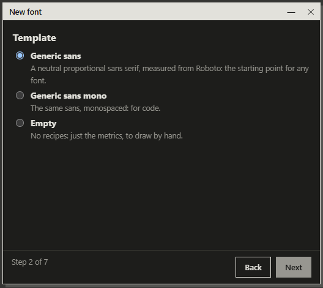

# Getting started

*[Español](../es/getting-started.md) · [Guide index](index.md)*

## 1. Create a font

**File → New font…** (Ctrl+N) opens a seven-step wizard:

1. **Name**: family and style.
2. **Template**: *Generic sans*, *Generic sans mono* or *Empty*. A template is a
   starting set of parameter values; the generic sans was measured from Roboto.
   *Empty* gives you metrics and no letters.
3. **Width mode**: monospaced (every glyph shares one advance) or proportional.
4. **Character set**: basic Latin, Western Europe, or a language (Spanish,
   Catalan/Valencian, Portuguese, French, German, Italian, English). It decides
   which accented letters and test texts you get.
5. **Metrics**: UPM, x-height, cap height, ascender, descender.
6. **Summary** of what will be created.
7. **Create**. With a recipe template the letters of the set are built right away.

When you press **Create…** you choose where to save the font, a UFO 3 folder. You
can also **Open UFO…** or **Import OTF/TTF…** to start from an existing font;
imported glyphs are manual (no recipe).

In **Preferences** (Ctrl+,) set the interface language and fonts, the **font
library** (a folder of .ttf/.otf files used as references in Compare) and the
**backups**: every few minutes a font with unsaved changes is copied to a backup
folder, and after a crash the app offers to recover it.

## 2. Look around

The window is made of **areas** you can dock, split, float and close. Layouts group
them for a task; switch with the selector at the top right or **Alt+1…9**:

- **Design**: font band, canvas, Inspector, text strip and the glyph's problems.
- **Spacing**: a tall text strip, canvas, Inspector and the Rhythm table.
- **Compare**: two canvases and the Inspector on its Compare tab.
- **Review**: a large font band and the problems of the whole font.

Any other area (Parameters, Kerning, Metrics…) opens from the ▾ menu of an area
(**Switch to…**) or from the command palette (Ctrl+K).

The **font band** at the top shows every glyph, filtered by folder (lowercase,
uppercase, accented, figures…). Click one to open it in the **canvas**. The **text
strip** shows words at several sizes as you type.

## 3. Change the font

Open the **Parameters** area (Ctrl+K → *Parameters*) and change *stem* (the thickness of the lowercase
stems). Every coupled letter is rebuilt. Undo with Ctrl+Z, or **Undo parameters**
to undo a parameter change across the whole font. See
[Parameters and recipes](parameters.md).

To draw a glyph by hand, **decouple** it (Glyph menu or the Inspector): its outline
stops following the parameters and the point editor works on it. **Recouple**
regenerates it from the recipe.

## 4. Check and export

1. **Font → Coverage…**: what is missing from your character set.
2. **Problems**: errors block export; warnings do not.
3. **Font → Font info…**: names, version, designer, license.
4. **File → Export…**: TTF, OTF and WOFF2. **Test installed** installs the TTF for
   your user so you can try it in any application.

Details in [Export and install](production.md).

## Keyboard

| Key           | Action                                    |
| ------------- | ----------------------------------------- |
| Ctrl+N        | New font                                  |
| Ctrl+S        | Save                                      |
| Ctrl+K        | Command palette                           |
| Ctrl+,        | Preferences                               |
| V / P / M     | Select / Pen / Mirror tool                |
| R             | Show reference fonts in the canvas        |
| Wheel / Space | Zoom / pan the canvas                     |
| Alt+1…9       | Switch layout                             |
| F6            | Move focus between areas                  |
| F1            | Guide page for the element under the pointer |
