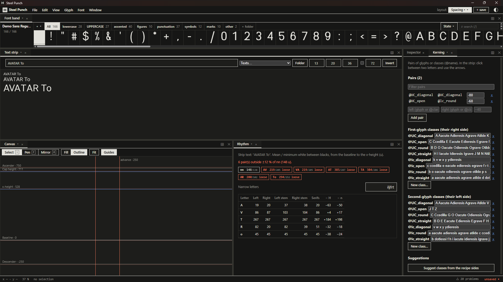

# Spacing

*[Español](../es/spacing.md) · [Guide index](index.md)*

Spacing is the white between letters. It matters as much as their shape: even
rhythm makes text read as words, not as letters.

## Width mode

The *width mode* parameter decides how advances are computed:

- **Monospaced**: every glyph has the same advance (the cell, *mono advance*) and
  its drawing is centered. Narrow letters (i, l, r, f) get longer feet to fill the
  cell; wide ones (m, w) are compressed.
- **Proportional**: each glyph's advance = left sidebearing + drawing width + right
  sidebearing.

## Sidebearings by side type (proportional)

In proportional mode the sidebearings come from the shape of each side, the classic
method of spacing *n* and *o* first and deriving the rest:

| Parameter        | Sides                                                         | Default            |
| ---------------- | ------------------------------------------------------------- | ------------------ |
| spaceStraight    | Straight sides: n, h, i, l, H, I…                             | —                  |
| spaceCurved      | Round sides: o, c, e, O, C…                                   | 0.8 × straight     |
| spaceDiagonal    | Diagonal sides: v, w, x, y, A, V…                             | can be ≈ 0 or negative |
| spaceOpen        | Open sides: right of c, r, f, t; z, T; punctuation            | 0.6 × straight     |
| capSpacing       | Multiplies the sidebearings of capitals                       |                    |
| figAdvance       | Common advance of the ten figures (tabular)                   |                    |
| spaceWidth       | Advance of the space                                          | 0.62 × n width     |

*lsbAdjust* and *rsbAdjust* fine-tune one glyph: use them as **local adjustments**
(see [Parameters](parameters.md#local-adjustments)).

## Checking the rhythm

- **Text strip**: type words or pick a test text (control strings such as *nnonoo*
  or *HHOHOO*, pangrams of the font's languages, code). **Folder** puts the letters of
  the active folder between control letters. **Invert** shows white on black.
- **Rhythm** area: measures the mean and minimum white between the letters of the
  strip, from the baseline to the x-height, and flags pairs that are more than ±12 %
  away from *nn*. A table compares each letter's sidebearings with H and n.

## Kerning

Kerning corrects specific pairs (AV, To, r.) that spacing alone cannot.

- **Kerning** area: pairs of glyphs or classes (`@name`), with a filter. In the text
  strip, click between two letters and use the arrow keys.
- **Classes**: first-glyph classes group glyphs by their right side; second-glyph
  classes by their left side.
- **Suggest classes from the recipe sides** groups the recipe letters by side type
  (straight, round, diagonal, open), lowercase and uppercase apart. Composites go
  with their base. You choose before anything is applied.

Kerning is saved in the UFO (`kerning.plist`, `groups.plist`) and exported to GPOS
`kern`.

