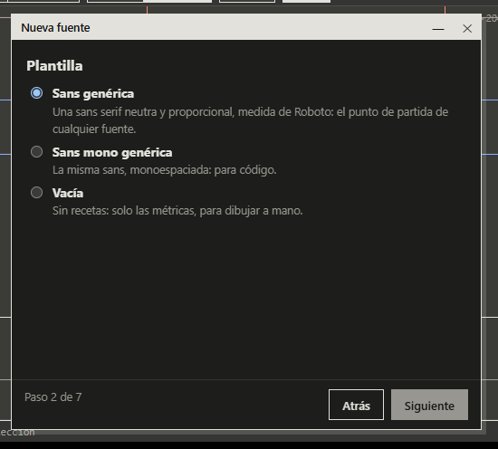

# Primeros pasos

*[English](../en/getting-started.md) · [Índice de la guía](index.md)*

## 1. Crear una fuente

**Archivo → Nueva fuente…** (Ctrl+N) abre un asistente de siete pasos:

1. **Nombre**: familia y estilo.
2. **Plantilla**: *Sans genérica*, *Sans mono genérica* o *Vacía*. Una plantilla es
   un juego inicial de valores de los parámetros; la sans genérica está medida de
   Roboto. *Vacía* trae las métricas y ninguna letra.
3. **Modo de anchos**: monoespaciada (todos los glifos con el mismo avance) o
   proporcional.
4. **Juego de caracteres**: latín básico, Europa occidental o un idioma (español,
   catalán/valenciano, portugués, francés, alemán, italiano, inglés). Decide qué
   letras acentuadas y qué textos de prueba tendrás.
5. **Métricas**: UPM, altura x, altura de mayúscula, ascendente, descendente.
6. **Resumen** de lo que se va a crear.
7. **Crear**. Con una plantilla de recetas, las letras del juego se construyen en el
   momento.

Al pulsar **Crear…** eliges dónde guardar la fuente, una carpeta UFO 3. También
puedes **Abrir UFO…** o **Importar OTF/TTF…** para partir de una fuente existente;
los glifos importados son manuales (sin receta).

En **Preferencias** (Ctrl+,) eliges el idioma y las fuentes de la interfaz, la
**biblioteca de fuentes** (una carpeta de .ttf/.otf que Comparar usa como
referencias) y las **copias de seguridad**: cada pocos minutos, una fuente con
cambios sin guardar se copia a una carpeta, y si la app se cierra mal ofrece
recuperarla.

## 2. Conocer la ventana

La ventana está hecha de **áreas** que puedes acoplar, dividir, hacer flotantes y
cerrar. Las disposiciones las agrupan para una tarea; cámbialas con el selector de
arriba a la derecha o con **Alt+1…9**:

- **Diseñar**: banda de fuente, lienzo, Inspector, tira de texto y los problemas del
  glifo.
- **Espaciar**: tira de texto alta, lienzo, Inspector y la tabla de Ritmo.
- **Comparar**: dos lienzos y el Inspector en su pestaña Comparar.
- **Revisar**: una banda de fuente grande y los problemas de toda la fuente.

Las demás áreas (Parámetros, Kerning, Métricas…) se abren desde el menú ▾ de un área
(**Cambiar a…**) o desde la paleta de comandos (Ctrl+K).

La **banda de fuente** de arriba muestra todos los glifos, filtrados por carpeta
(minúsculas, mayúsculas, acentuadas, cifras…). Pulsa uno para abrirlo en el
**lienzo**. La **tira de texto** muestra palabras a varios tamaños mientras escribes.

## 3. Cambiar la fuente

Abre el área **Parámetros** (Ctrl+K → *Parámetros*) y cambia *asta* (el grosor de
las astas de las minúsculas). Todas las letras acopladas se reconstruyen. Deshaz con
Ctrl+Z, o con **Deshacer parámetros** para deshacer un cambio de parámetros en toda
la fuente. Ver [Parámetros y recetas](parameters.md).

Para dibujar un glifo a mano, **desacóplalo** (menú Glifo o el Inspector): su
contorno deja de seguir a los parámetros y el editor de puntos trabaja sobre él.
**Reacoplar** lo regenera desde la receta.

## 4. Comprobar y exportar

1. **Fuente → Cobertura…**: lo que falta de tu juego de caracteres.
2. **Problemas**: los errores bloquean la exportación; los avisos no.
3. **Fuente → Información de la fuente…**: nombres, versión, diseñador, licencia.
4. **Archivo → Exportar…**: TTF, OTF y WOFF2. **Probar instalada** instala el TTF
   para tu usuario y puedes probarla en cualquier aplicación.

Detalles en [Exportar e instalar](production.md).

## Teclado

| Tecla           | Acción                                          |
| --------------- | ----------------------------------------------- |
| Ctrl+N          | Nueva fuente                                    |
| Ctrl+S          | Guardar                                         |
| Ctrl+K          | Paleta de comandos                              |
| Ctrl+,          | Preferencias                                    |
| V / P / M       | Herramienta Seleccionar / Pluma / Espejo        |
| R               | Ver las fuentes de referencia en el lienzo      |
| Rueda / Espacio | Zoom / mover el lienzo                          |
| Alt+1…9         | Cambiar de disposición                          |
| F6              | Pasar el foco de un área a otra                 |
| F1              | Página de la guía del elemento bajo el puntero  |
