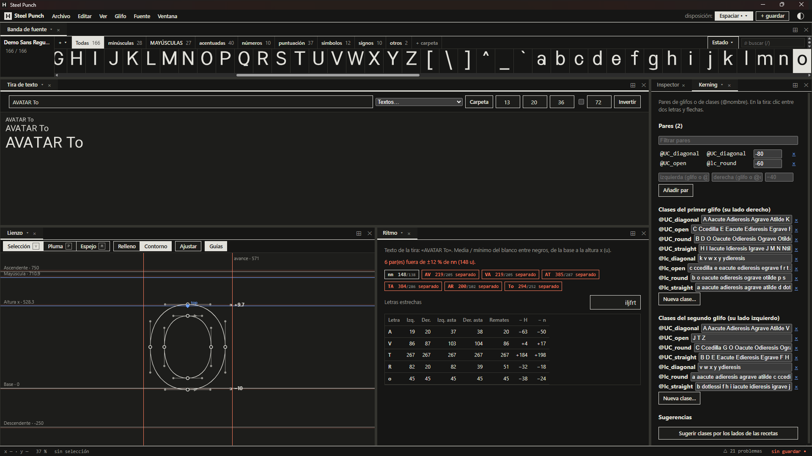

# Espaciado

*[English](../en/spacing.md) · [Índice de la guía](index.md)*

El espaciado es el blanco entre letras. Importa tanto como su forma: un ritmo
parejo hace que el texto se lea como palabras y no como letras sueltas.

## Modo de anchos

El parámetro *modo de anchos* decide cómo se calculan los avances:

- **Monoespaciada**: todos los glifos tienen el mismo avance (la celda, *avance
  mono*) y el dibujo va centrado. Las letras estrechas (i, l, r, f) llevan pies más
  largos para llenar la celda; las anchas (m, w) se comprimen.
- **Proporcional**: el avance de cada glifo = margen izquierdo + ancho del dibujo +
  margen derecho.

## Márgenes por tipo de lado (proporcional)

En proporcional, los márgenes salen de la forma de cada lado: el método clásico de
espaciar primero la *n* y la *o* y derivar el resto.

| Parámetro               | Lados                                                       | Por defecto          |
| ----------------------- | ----------------------------------------------------------- | -------------------- |
| margen de lado recto    | Lados rectos: n, h, i, l, H, I…                             | —                    |
| margen de lado curvo    | Lados curvos: o, c, e, O, C…                                | 0,8 × el recto       |
| margen de lado diagonal | Lados diagonales: v, w, x, y, A, V…                         | puede ser ≈ 0 o negativo |
| margen de lado abierto  | Lados abiertos: derecha de c, r, f, t; z, T; puntuación     | 0,6 × el recto       |
| factor de las mayúsculas | Multiplica los márgenes de las mayúsculas                  |                      |
| avance de las cifras    | Avance común de las diez cifras (tabulares)                 |                      |
| ancho del espacio       | Avance del espacio                                          | 0,62 × ancho de la n |

*Ajuste del margen izquierdo* y *derecho* afinan un glifo: úsalos como **ajustes
locales** (ver [Parámetros](parameters.md#ajustes-locales)).

## Comprobar el ritmo

- **Tira de texto**: escribe palabras o elige un texto de prueba (tiras de control
  como *nnonoo* o *HHOHOO*, pangramas de los idiomas de la fuente, código).
  **Carpeta** pone las letras de la carpeta activa entre letras de control.
  **Invertir** muestra blanco sobre negro.
- Área **Ritmo**: mide el blanco medio y mínimo entre las letras de la tira, de la
  base a la altura x, y señala los pares que se alejan más de un ±12 % de *nn*. Una
  tabla compara los márgenes de cada letra con los de la H y la n.

## Kerning

El kerning corrige pares concretos (AV, To, r.) que el espaciado solo no arregla.

- Área **Kerning**: pares de glifos o de clases (`@nombre`), con filtro. En la tira de
  texto, pulsa entre dos letras y usa las flechas.
- **Clases**: las de primer glifo agrupan glifos por su lado derecho; las de segundo
  glifo, por su lado izquierdo.
- **Sugerir clases por los lados de las recetas** agrupa las letras con receta por
  tipo de lado (recto, curvo, diagonal, abierto), minúsculas y mayúsculas aparte. Los
  compuestos van con su base. Eliges tú antes de aplicar nada.

El kerning se guarda en el UFO (`kerning.plist`, `groups.plist`) y se exporta como
`kern` en GPOS.

